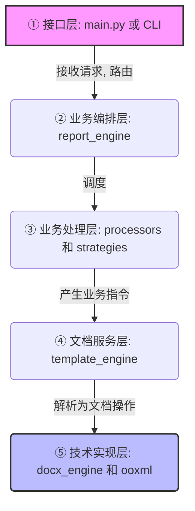

# 01. 顶层架构设计

> **Author:** Minna
> **Architecture Version:** v6.4
> **Design Pattern:** 五层分离架构 / 策略驱动 / 零硬编码

## 1. 设计原则

- **模块化**：按职责拆分为独立模块，单模块代码控制在 200 行以内。
- **高内聚低耦合**：模块间通过明确的数据结构交互。
- **交互与逻辑分离**：所有业务逻辑不依赖特定用户交互方式（CLI / GUI / API 均可调用）。
- **开放封闭原则**：新增测试类型时新增策略，不修改已有稳定模块。
- **零硬编码原则**：所有路径、设备编号、测试数据均从配置文件读取。

## 2. 核心架构：五层分离

系统强制划分为五层，严禁跨层调用。每一层只说清"自己该说什么"，把"不该管的"推给相邻层。



### 2.1 五层职责边界（强制约束）

| 层级 | 文件 | 允许做的事情 | 严禁做的事情 |
|------|------|--------------|--------------|
| ① 接口层 | `main.py` | 解析参数、路由、调用 `report_engine` | 操作文档对象、调用 `DocumentEngine` |
| ② 业务编排层 | `report_engine.py` | 调度 Processor / Strategy、收集结果 | 直接调用 `DocumentEngine`、处理 Word 细节 |
| ③ 业务处理层 | `processors/`、`strategies/` | 执行业务逻辑、产生业务指令 | 调用 `DocumentEngine`、导入 `python-docx` |
| ④ 文档服务层 | `template_engine.py` | 接收指令、配置驱动定位、调用引擎 | 暴露段落 / 表格对象给上层、包含业务逻辑 |
| ⑤ 技术实现层 | `docx_engine.py`、`ooxml_service.py` | 实现具体文档操作 (`python-docx` / OOXML) | 包含业务逻辑 |

**一句话分工**：业务层说"生成什么"，文档服务层说"在哪里生成"，文档技术层说"如何操作文档"，技术实现层说"用什么技术"。

## 3. 关键设计决策（为什么这么设计）

### 3.1 为什么使用 GenericProcessor + Strategy 模式？

**背景**：原有设计中，不同类型的测试（如外观、电性、可靠性）的代码 90% 是重复的（公共字段填充、设备表、Test Result 判定等）。

**决策**：统一使用一个 `GenericProcessor` 处理所有公共字段，将类型特有的逻辑（如图片匹配、Excel 转换）下沉到独立的 `Strategy` 中。新增测试类型只需新增 `Strategy` 文件并注册，符合开放封闭原则，核心引擎零修改。

### 3.2 为什么拆分静态配置与运行时数据？

**背景**：物料类别配置（静态策略）在同一物料类别内可复用，而设备编号、测试条件等运行时数据每颗料独立。混在一起导致配置臃肿、缓存失效。

**决策**：拆分为三个上下文对象：

- `ChapterConfig`：纯静态策略配置（可缓存）。
- `ChapterRuntime`：每次运行的动态数据。
- `ChapterContext`：一次报告生成中某章节的完整上下文（Config + Runtime + 物料类别等）。

### 3.3 为什么引入 DocumentEngine 抽象接口？

**背景**：彻底解除对 Windows COM 组件的依赖，为跨平台（Linux / PLM 系统）部署铺路。业务层若直接依赖 `python-docx` 或 COM，迁移时牵一发动全身。

**决策**：定义标准的文档操作接口（`open` / `save` / `insert_image` / `find_section` 等），业务层不感知底层技术实现，最终通过 `engine_factory` 返回具体的 `docx_engine` 实例。换引擎只需改一行配置，可随时回滚。

### 3.4 为什么 Processor/Strategy 通过"业务指令"而非直接调用 DocumentEngine？

**背景**：若 Strategy 直接操作文档，业务层与技术实现层耦合，任何 Word 细节变动都会击穿到策略代码，且无法在脱离 Word 的环境下做单元测试。

**决策**：`Strategy` 不直接调用 `DocumentEngine` 或 `template_engine` 的文档方法，而是返回结构化业务指令（如 `{"action":"insert_image", "section":..., "placeholder":..., "image_data":..., "width_cm":...}`），由 `template_engine` 解析后调用 `DocumentEngine`。`Strategy` 不导入 `python-docx` / `lxml` / `DocumentEngine`，业务层与技术实现完全解耦。

### 3.5 为什么 DocumentEngine 不含 find_bookmark()？

**背景**：`python-docx` 对 Word 书签支持极差，依赖书签定位极易因模板微调而失效。

**决策**：系统已采用配置驱动定位（物料类别配置表维护插入位置），不再依赖书签作为主定位机制；保留书签会诱导业务层依赖书签，与方向冲突。故彻底删除 `find_bookmark()`。

### 3.6 为什么放弃书签，改用占位符？

**背景**：书签脆弱且对大模型不友好。

**决策**：模板中写入 `{front}`、`{back}` 等纯文本占位符，脚本通过文本搜索在章节内定位（自动去括号），插入图片后保留占位符文本作说明标签。支持 `{}` / `[]` / `<>` 括号风格。配置表"书签列表"相应改名为"占位符列表"。

### 3.7 为什么不实现页码自动更新？

**背景**：页码由 Word 打开文档时自动计算（PAGE / NUMPAGES 域），在代码中更新页码依赖 COM。

**决策**：与"解除 Office 依赖"目标冲突，禁止在 `DocumentEngine` / `template_engine` / `report_engine` 中实现页码更新；必要时在导出 PDF 阶段处理。

## 4. 数据流概览

```
Strategy 生成业务指令（不操作文档）
   → template_engine 配置驱动定位章节/锚点
      → DocumentEngine（docx_engine）执行具体操作（python-docx + OOXML）
         → 写出 .docx
```

单章节执行失败不影响整份报告：错误记入日志并继续，最终结论只依赖 `test_result` 字段判定（见 [03. 人机协同开发纪律](docs/03_AI_Development_Rules.md)）。
